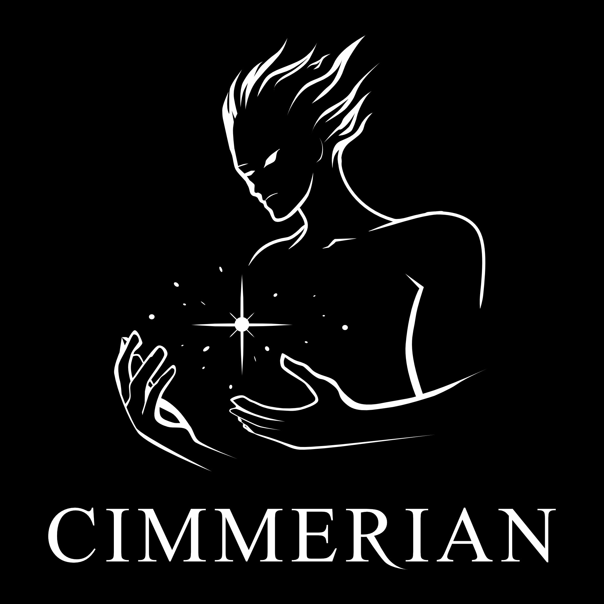

# Cimmerian

<p align="center">

</p>

A modern C++26 unit testing framework. BDD-style test authoring, visual diff output on failure, and built-in performance timing — with zero external dependencies.

```
[Math]
[PASS] [Math] adds two numbers  (0.0003ms)
[PASS] [Math] computes fibonacci  (0.0267ms)
[Math] group total: 0.0623ms

[Strings]
[FAIL] [Strings] compares greetings  (0.0058ms)

      Strings differ:

            Expected  "hello world"
            Received  "hello wurld"

      at math.test.cpp:17

[Strings] group total: 0.0146ms


────────────────────────────────────────────────
Summary: 3 total, 2 passed, 1 failed

Slowest: [Math] computes fibonacci (0.0267ms)
────────────────────────────────────────────────
```

---

## Requirements

- C++26
- CMake 3.30+
- GCC 14+, Clang 19+, or a recent AppleClang
- On Windows, clang-cl from Clang 19+; MSVC's cl.exe isn't supported

---

## Installation

Clone the repository and add it as a subdirectory in your CMake project:

```bash
git clone https://github.com/DeanWilsonDev/Cimmerian.git
```

```cmake
# CMakeLists.txt
add_subdirectory(Cimmerian)

add_executable(my_tests
  test/my.test.cpp
  test/test-main.cpp
)

target_link_libraries(my_tests PRIVATE cimmerian)
target_compile_features(my_tests PUBLIC cxx_std_26)
```

Install locally as library:

```
cmake -B build -DCMAKE_INSTALL_PREFIX=$HOME/.local -DCIMMERIAN_BUILD_TESTS=OFF
cmake --build build
cmake --install build
```

### Optional features

Snapshot testing (`cimmerian/snapshot.hpp`) and visual regression testing
(`cimmerian/visual.hpp`) are off by default — they aren't compiled into the
library unless you ask for them, so most consumers pay no extra compile time
for either. Enable whichever you need at configure time, independently:

```
cmake -B build -DCIMMERIAN_ENABLE_SNAPSHOT_TESTING=ON -DCIMMERIAN_ENABLE_VISUAL_TESTING=ON
```

Including `cimmerian/snapshot.hpp` or `cimmerian/visual.hpp` without enabling
the matching option fails fast at compile time with a `#error` pointing at
the flag to set, rather than an obscure link error.

Building Cimmerian on its own turns snapshot testing on, so its own snapshot
tests run. Visual testing stays off there too, because its backend needs a
display and platform packages (libXtst on Linux). Pass
`-DCIMMERIAN_ENABLE_VISUAL_TESTING=ON` to build and run Cimmerian's visual
self-tests.

On a machine without X11, such as macOS,
`tools/x11-capture-stability/run-in-docker.sh` builds the X11 backend in a
Linux container and measures how its capture copes with a window that's
repainted mid-capture.

---

## Quick Start

**1.Either:**

- A. Write a test entry point:

```cpp
// test/test-main.cpp
#include "cimmerian/test.hpp"

int main(int argc, char* argv[]) {
  Cimmerian::ParseArgs(argc, argv); // --filter, --list, --shard, --forbid-only, ...
  Cimmerian::TestRunner runner;
  auto summary = runner.RunAll(&Cimmerian::TestRegistry::GetInstance());
  return summary.failed > 0 ? 1 : 0;
}
```

- B. Use the provided entry point:

```cpp
// test/test-main.cpp
#include <cimmerian/test-entry-point.hpp>
```


**2. Write your tests**

```cpp
// test/math.test.cpp
#include "cimmerian/test.hpp"
#include <vector>

DESCRIBE("Math", {
  IT("adds two numbers", {
    ASSERT_EQUAL(1 + 1, 2);
  });

  IT("compares vectors", {
    std::vector<int> a = {1, 2, 3};
    std::vector<int> b = {1, 2, 3};
    ASSERT_EQUAL(a, b);
  });
});
```

**3. Build and run**

```bash
cmake -B build
cmake --build build
./build/my_tests
```

---

## Authoring Tests

### `DESCRIBE` — group your tests

Groups can be nested arbitrarily. Each `DESCRIBE` inside another creates a child group.

```cpp
DESCRIBE("User", {
  DESCRIBE("Authentication", {
    IT("accepts a valid token", { ... });
    IT("rejects an expired token", { ... });
  });

  DESCRIBE("Profile", {
    IT("returns the correct username", { ... });
  });
});
```

### `IT` / `TEST` — define a test case

`IT` and `TEST` are aliases — use whichever reads better.

```cpp
IT("returns zero for empty input", {
  ASSERT_EQUAL(compute(""), 0);
});
```

A body can hold anything a function body can, including brace-initialisers
with commas:

```cpp
IT("falls back to the default colour", {
  Color fallback{1, 2, 3, 4};
  ASSERT_EQUAL(resolve(nullptr), fallback);
});
```

The same goes for `DESCRIBE` and the lifecycle hooks. The two-argument
assertion macros are the exception: they have to split their arguments at
the comma, so wrap a brace-initialised argument in parentheses:
`ASSERT_EQUAL(values, (std::vector<int>{1, 2}))`.

### `IT_FN` / `TEST_FN` — register a function as a test

Useful for table-driven or shared test logic. Takes a function or a lambda,
captures included.

```cpp
void myTest(void*) {
  ASSERT_TRUE(someCondition());
}

IT_FN("my test", myTest);
IT_FN("doubles its input", [factor = 2, input = 21](void*) {
  ASSERT_EQUAL(input * factor, 42);
});
```

### Lifecycle hooks

```cpp
DESCRIBE("Database", {
  BEFORE_ALL({ db_connect(); });
  AFTER_ALL({ db_disconnect(); });
  BEFORE_EACH({ db_clear(); });
  AFTER_EACH({ db_reset(); });

  IT("inserts a record", { ... });
  IT("finds a record", { ... });
});
```

| Hook | Runs |
|---|---|
| `BEFORE_ALL` | Once before all tests in the group |
| `AFTER_ALL` | Once after all tests in the group |
| `BEFORE_EACH` | Before every test in the group |
| `AFTER_EACH` | After every test in the group |

If `BEFORE_ALL` fails an assertion or throws, every test in its group fails
without running, nested groups included. `AFTER_ALL` still runs, to tear down
whatever was set up. A failed `AFTER_ALL` gets its own `[FAIL]` line and fails
the run, even if every test passed. Either way, the summary names the hook:

```
[Database]
[FAIL] [Database] BEFORE_ALL

      ASSERT_TRUE failed: connected

      at db.test.cpp:8

[FAIL] [Database] inserts a record  (not run: BEFORE_ALL failed)
[FAIL] [Database] finds a record  (not run: BEFORE_ALL failed)
...
Summary: 5 total, 3 passed, 2 failed
BEFORE_ALL failed in [Database], so 2 tests didn't run
```

### Skipping and focusing tests

Append `_SKIP` or `_ONLY` to any test or group macro.

```cpp
DESCRIBE("Parser", {
  IT_SKIP("handles unicode", { ... });   // never runs, printed as [SKIP]
  IT_ONLY("handles commas", { ... });    // focus: only _ONLY tests run
});

DESCRIBE_SKIP("Legacy", { ... });        // skips every test inside, nested groups included
DESCRIBE_ONLY("Tokenizer", { ... });     // focuses every test inside
```

| Base | Variants |
|---|---|
| `DESCRIBE` | `DESCRIBE_SKIP`, `DESCRIBE_ONLY` |
| `TEST` / `IT` | `TEST_SKIP`, `TEST_ONLY`, `IT_SKIP`, `IT_ONLY` |
| `TEST_FN` / `IT_FN` | `TEST_FN_SKIP`, `TEST_FN_ONLY`, `IT_FN_SKIP`, `IT_FN_ONLY` |
| `VISUAL_DESCRIBE` | `VISUAL_DESCRIBE_SKIP`, `VISUAL_DESCRIBE_ONLY` |
| `VISUAL_DESCRIBE_COMPONENT` | `VISUAL_DESCRIBE_COMPONENT_SKIP`, `VISUAL_DESCRIBE_COMPONENT_ONLY` |
| `VISUAL_TEST` | `VISUAL_TEST_SKIP`, `VISUAL_TEST_ONLY` |

- A single `_ONLY` anywhere in the test binary, unit or visual, focuses the
  whole run. Every other test is skipped without being printed, and the
  summary notes that the run was focused.
- `_SKIP` always wins: a test that is both skipped and focused (e.g. an
  `IT_ONLY` inside a `DESCRIBE_SKIP`) is skipped and does not focus the run.
- Hooks don't run for skipped tests. A group's `BEFORE_ALL`/`AFTER_ALL` run
  only if at least one test inside it runs.
- Skipped tests count toward the total and are reported as skipped:
  `Summary: 10 total, 7 passed, 0 failed, 3 skipped`.

#### Guarding against committed markers in CI

```bash
./build/my_tests --forbid-only --forbid-skip
```

| Flag | Effect |
|---|---|
| `--forbid-only` | Fails the run if any test is marked `_ONLY` (directly or via `DESCRIBE_ONLY`). `_ONLY` also stops focusing the run. |
| `--forbid-skip` | Fails the run if any test is marked `_SKIP` (directly or via `DESCRIBE_SKIP`). |

When a forbidden test is found, no tests in that runner (unit or visual)
are run. The runner lists every offending test with its full group path and
counts each one as a failure, so the process exits non-zero:

```
[ERROR] 2 forbidden test(s) found, not running any tests:
  Parser > handles commas  (_ONLY is forbidden by --forbid-only)
  Legacy > old path  (_SKIP is forbidden by --forbid-skip)
```

The provided entry point (`cimmerian/test-entry-point.hpp`) parses both
flags. A hand-written `main` needs to call `Cimmerian::ParseArgs(argc, argv)`,
as in the Quick Start example.

---

## Assertions

Every assertion takes the actual value first and the expected value second:
`ASSERT_EQUAL(lexer.TextOf(token), "signal")`.

### Continuing assertions

These report failure and continue running the rest of the test.

| Macro | Fails when |
|---|---|
| `ASSERT_TRUE(cond)` | `cond` is false |
| `ASSERT_FALSE(cond)` | `cond` is true |
| `ASSERT_EQUAL(actual, expected)` | `actual != expected` |
| `ASSERT_NOT_EQUAL(actual, expected)` | `actual == expected` |
| `ASSERT_NEAR(actual, expected, epsilon)` | `actual` and `expected` differ by more than `epsilon` |
| `ASSERT_NULL(ptr)` | `ptr` isn't null |
| `ASSERT_NOT_NULL(ptr)` | `ptr` is null |
| `ASSERT_THROWS(expression, ExceptionType)` | `expression` doesn't throw, or throws something other than `ExceptionType` |
| `ASSERT_NO_THROW(expression)` | `expression` throws |

### Halting assertions

These report failure and immediately stop the current test via `return`.

| Macro | Fails when |
|---|---|
| `REQUIRE_TRUE(cond)` | `cond` is false |
| `REQUIRE_FALSE(cond)` | `cond` is true |
| `REQUIRE_EQUAL(actual, expected)` | `actual != expected` |
| `REQUIRE_NOT_EQUAL(actual, expected)` | `actual == expected` |
| `REQUIRE_NEAR(actual, expected, epsilon)` | `actual` and `expected` differ by more than `epsilon` |
| `REQUIRE_NULL(ptr)` | `ptr` isn't null |
| `REQUIRE_NOT_NULL(ptr)` | `ptr` is null |
| `REQUIRE_THROWS(expression, ExceptionType)` | `expression` doesn't throw, or throws something other than `ExceptionType` |
| `REQUIRE_NO_THROW(expression)` | `expression` throws |

Use these when a later line only makes sense if the check passed, such as a
size check that guards an index. A continuing assertion would carry on and
read out of bounds.

### Testing failures

For testing your own assertion helpers. A captured failure doesn't fail the
surrounding test.

| Macro | Does |
|---|---|
| `ASSERT_FAILS(expression)` | Fails if `expression` doesn't report a failure |
| `CAPTURE_FAILURE(expression)` | Returns the first failure `expression` reported as a `std::optional<Cimmerian::TestFailRecord>` (`file`, `line`, `message`, `details`) |
| `CAPTURE_FAILURE_MESSAGE(expression)` | The same failure as a `std::optional<std::string>`, with the message and detail lines joined by newlines |

---

## Failure Output

Each failure prints under its test's `[FAIL]` line as a block: a one-line
reason, the detail lines, and the place it failed. A test that fails more
than once gets one block per failure.

```
[FAIL] [Inventory] counts stock  (0.0041ms)

      Containers differ in size (expected 4, received 3), first at index 2:

            Expected  [1, 2, 3, 4]
            Received  [1, 2, 9, ∅]

      at inventory.test.cpp:9
```

`ASSERT_EQUAL` shows a diff for scalars, `std::string`, `const char*`,
C-style arrays, and any iterable container whose elements implement
`std::format`. Strings are compared character by character and containers
element by element. In the terminal, `Expected` is green and `Received` is
red, and the parts that differ are highlighted. `∅` marks something
`Received` is missing, and an element it has but shouldn't is shown struck
through. A container's first line says where to look: the first index that
differs, how many indexes differ, and both sizes when they don't match.

**Scalars**
```
      Values differ:

            Expected  42
            Received  43
```

**Strings**
```
      Strings differ:

            Expected  "hello world"
            Received  "hello wurld"
```

**Containers**
```
      Containers differ in size (expected 2, received 3), first at index 2:

            Expected  [1, 2]
            Received  [1, 2, 3]
```

```
      Containers differ at 2 indexes, first at index 1:

            Expected  [1, 2, 3, 4]
            Received  [1, 7, 3, 8]
```

**`ASSERT_NEAR`**
```
      Values not within epsilon:

            Expected  1.5 ± 0.01
            Received  1
```

**`ASSERT_SNAPSHOT`** (visual testing)
```
[FAIL] [Settings] shows the save button

      Snapshot 'save-button' differs from its golden in 3.20% of pixels (allowed 0.50%):

            Golden  snapshots/settings/shows-the-save-button/save-button.golden.png
            Actual  snapshots/settings/shows-the-save-button/save-button.actual.png
            Diff    snapshots/settings/shows-the-save-button/save-button.diff.png

            Run with --update-snapshots to accept the new image.

      at settings.test.cpp:21
```

A visual test fails the same way on an `ASSERT_*` in its body or an
exception, in every run mode. With `--review-snapshots`, a differing
snapshot goes to the HTML report instead of failing its test.

### When a test throws

An exception that escapes a test body, `BEFORE_EACH` or `AFTER_EACH` fails
that test, and the run carries on. `what()` becomes the detail. A throwing
`BEFORE_EACH` skips the test's body but still runs `AFTER_EACH`.

```
[FAIL] [Config] loads the settings file  (0.0094ms)

      The test threw an exception:

            settings.toml: no such file
```

An exception escaping `BEFORE_ALL` or `AFTER_ALL` fails that hook, as
described under [Lifecycle hooks](#lifecycle-hooks).

### When a test crashes

A memory fault, such as an out-of-bounds read, still ends the whole run, but
first the runner writes a line to stderr naming what was running:

```
[PASS] [Parser] handles commas  (0.0094ms)

[CRASH] SIGSEGV (invalid memory access) in [Parser > Nested] handles quotes, in BEFORE_EACH
```

- It covers SIGSEGV, SIGBUS, SIGFPE, SIGILL, SIGTRAP and SIGABRT (a failed
  `assert`, or an exception that escapes outside any test), in a test body,
  any hook or a visual test. A stack overflow is reported too.
- Everything printed before the crash is flushed first, so it isn't lost when
  the output goes to a pipe or a file.
- The process then ends with the same signal as before, so a CI job or CTest
  still sees a crash. A signal handler the host installed before `RunAll` still
  runs after the line.

Use `REQUIRE_*` to stop a test before it reads past a failed check.

### Reporting a failure from your own helper

Pass `__FILE__` and `__LINE__` (or a `std::source_location`) so the failure
points at the caller:

```cpp
void AssertLintClean(const LintResult& result, std::source_location where = std::source_location::current()) {
  if (result.Clean()) return;
  Cimmerian::Assertions::fail(
      where.file_name(), static_cast<int>(where.line()), "lint is not clean:", result.Violations()
  );
}
```

`Assertions::fail(file, line, message, details)` takes the detail lines as a
`std::vector<std::string>`. If you already have one preformatted string,
`Cimmerian::TestFailHandlerRegistry::GetInstance().NotifyTestFail(file, line, text)`
uses its first line as the message and the rest as detail lines.

---

## Performance Timing

Every test is timed automatically. No configuration required.

```
[Math]
[PASS] [Math] adds two numbers  (0.0003ms)
[PASS] [Math] computes fibonacci  (0.0267ms)
[Math] group total: 0.0623ms


────────────────────────────────────────────────
Summary: 2 total, 2 passed, 0 failed

Slowest: [Math] computes fibonacci (0.0267ms)
────────────────────────────────────────────────
```

Timing is reported per test, per group, for the total suite, and highlights the slowest test in the summary.

---

## Picking and Sharding Tests

```bash
./build/my_tests --filter "Parser > handles"   # run only the tests whose name contains this
./build/my_tests --list                        # print the tests a run would run, one per line
./build/my_tests --shard 2/4                   # run the 2nd of 4 slices of the suite
```

| Flag | Effect |
|---|---|
| `--filter <pattern>` | Runs only the tests whose full name contains `pattern`. Case matters. |
| `--list` | Prints the full name of each test a run with the same flags would run, then exits without running anything. |
| `--shard <index>/<count>` | Runs the `index`-th of `count` slices, counting from 1. |
| `--save-timings <file>` | After the run, writes how long each top-level `DESCRIBE` took. |
| `--timings <file>` | Makes `--shard` balance the slices by the times in `file`. |

`--filter=<pattern>` and `--shard=<index>/<count>` work too. The flags
combine: `--filter` picks the tests, `--shard` slices what it picked, and
`_SKIP`/`_ONLY` apply within the slice.

A test's full name is its group path and its name, as `--list` prints it:
`Parser > Nested > handles commas`. A test outside every `DESCRIBE` is just
its name. A filter that matches nothing runs nothing and passes, with a
warning in the summary.

### Running shards in parallel

Run every shard as its own process at the same time, and the suite takes
about as long as its slowest shard. The shards together run each test exactly
once:

- Each top-level `DESCRIBE` goes to one shard, with everything nested in it,
  so its hooks and shared state work as they do in a full run.
- The groups are spread so each shard has about the same number of tests,
  or about the same time with `--timings` (see below). Every process works
  out the same split from the same binary, flags and timings file.
- Each shard's summary and exit code cover only its own tests, so the run
  passes if every shard exits 0. A shard can end up with no tests; it passes.
- In a binary that also runs visual tests, they all run in shard 1, so only
  one process drives the screen.
- `--update-snapshots` can't be used with `--shard`: parallel shards would
  write the same snapshot files. Update snapshots in one unsharded run.

CTest can run the shards for you:

```cmake
enable_testing()
foreach(shard RANGE 1 8)
  add_test(NAME my_tests_${shard}of8 COMMAND my_tests --shard ${shard}/8)
endforeach()
```

```bash
ctest --test-dir build -j 8
```

### Balancing shards by time

Test count isn't time. A group of three tests that each start an app can
take longer than a hundred quick ones, and splitting by count can put several
slow groups in one shard. To split by time instead, record how long each
top-level group takes, then pass the file to every shard:

```bash
./build/my_tests --save-timings test-timings.txt                     # once, unsharded
./build/my_tests --shard 2/4 --timings test-timings.txt               # in every shard
```

- A group weighs its recorded time, scaled to the tests it runs now, so a
  group that gained tests or that `--filter` cuts down weighs what it will
  take. A group with no recorded time, such as a new one, weighs its tests at
  the mean time of a recorded test.
- Times include the group's hooks and nested groups.
- If the file doesn't exist yet, the shards balance by test count, and each
  shard's summary says so. If it can't be read or parsed, the run stops with
  an error, since shards that read it differently would split the tests
  differently and run some twice or not at all.
- A shard can save its own groups' times with `--save-timings`, but not over
  the `--timings` file it reads: a shard that started later would see a
  different file. Save each shard to its own file and concatenate them. Each
  line is one group, and a later line for a group replaces an earlier one:

```bash
cat test-timings-*.txt > test-timings.txt
```

No shard can finish faster than the slowest single top-level group, so
split a group that takes much longer than the rest.

The provided entry point reads these flags. A hand-written `main` needs to
call `Cimmerian::ParseArgs(argc, argv)`. A visual runner's
`VisualTestRunner::ParseArgs` reads them too.

---

## Project Structure

```
Cimmerian/
├── include/cimmerian/                  — public headers
│   ├── test.hpp                        — single include entry point
│   ├── test-entry-point.hpp            — ready-made main()
│   ├── test-args.hpp                   — Cimmerian::ParseArgs, for a hand-written main()
│   ├── test-registry.hpp               — test tree registration
│   ├── test-runner.hpp                 — execution, timing and failure layout
│   ├── test-selection.hpp              — --filter, --list and --shard
│   ├── test-timings.hpp                — --save-timings and --timings files
│   ├── crash-report.hpp                — the [CRASH] line on a fatal signal
│   ├── test-assertions.hpp             — typed assertions and diff output
│   ├── test-fail-record.hpp            — a failure: file, line, message, detail lines
│   ├── test-fail-handler-registry.hpp  — where assertions report failures
│   ├── test-mode.hpp                   — _SKIP / _ONLY resolution and --forbid-* flags
│   ├── test-log.hpp                    — coloured terminal logging
│   ├── ansi-formatter.hpp              — ANSI colour helpers
│   ├── snapshot.hpp, snapshot/         — snapshot testing (optional)
│   └── visual.hpp, visual/             — visual regression testing (optional)
├── src/                                — implementation files
├── test/                               — Cimmerian's own self-tests
├── snapshots/                          — golden images for the visual self-tests
├── tools/x11-capture-stability/        — measures X11 capture against mid-capture repaints
└── CMakeLists.txt
```

---

## Contributing

Cimmerian will not be accepting contributions at this time. Feel free to raise an issue if you have a problem and I will try to resolve it quickly. Thank you.

---

## License

MIT — see [LICENSE](LICENSE) for details.
